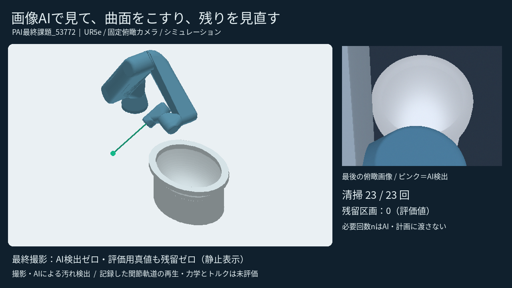

# 画像AIで汚れを見つけ、曲面を清掃して見直すロボット

Physical AI 応用1 最終課題 / OmniCampus ID: **53772**

固定俯瞰カメラとブラシ付きUR5eを想定し、便器内側の一部分を清掃するシミュレーションです。
画像AIで汚れを検出し、3D位置と工具姿勢から関節角度を計算。こすった後は退避して撮影し、残っていれば繰り返します。

- **[提出動画（YouTube・95秒）](https://youtu.be/j69k0yDYFY0)**
- **[提出用PDF](submission/説明資料_PAI最終課題_53772.pdf)**
- [動画ファイル](submission/PAI最終課題_53772.mp4)
- [仕組み・講義との対応・動作検証](physical_ai_toilet_lab/docs/12_閉ループ検証と提出.md)
- **[Dockerでの再現手順](physical_ai_toilet_lab/REPRODUCE_SUBMISSION.md)**
- [実装と各段階の記録](physical_ai_toilet_lab/README.md)

## 構成

RGB画像 → 学習済み小型U-Net → 汚れ領域 → 既知曲面との交点による3D位置 → 逆運動学 → 衝突検査 → 清掃 → 再撮影。

学習するのは画像認識です。関節角度は数値計算し、動作方策やトルクを学習してはいません。
講義の順・逆運動学、観測と行動のフィードバック、認識と制御の分離を活用しています。
Pythonによる運動学シミュレーションであり、実機・ROS/Gazeboの実行映像ではありません。

## 検証結果

| 条件 | 清掃回数 | 終了時の残留区画 |
|---|---:|---:|
| 新規配置410001 | 23 | 0 |
| 新規配置410002 | 20 | 0 |
| 新規配置410003 | 36 | 0 |
| 汚れなし | 0 | 0 |
| 落ちない設定（上限3回） | 3 | 166：未完了として停止 |

通常配置には局所通過回数n=1・3・5で落ちる汚れを混在。nと正解座標は行動計画へ渡していません。
保存された全実行姿勢の衝突再検査など、40テストが成功しています。
画像認識は合成画像600枚で学習、120枚で調整、未使用120枚で評価。test IoUは99.992%。同じ仮便器・カメラでの結果です。

## 範囲と限界

便器は仮形状、接触は距離・姿勢・移動量・通過回数の簡易モデルです。
力学、押付け力、モーター追従、トルク、水・洗剤・除菌効果は未評価です。実機でそのまま使用できる軌道ではありません。
動画は検証ログから5区間を抜粋し、区間内2倍速・区間間省略を明記。元の予定動作時間は約580.48秒です。

## コード・データ・権利

`physical_ai_toilet_lab/` にコード、合成データ、学習済み重み、検証ログ、公式UR5eモデルを収録。
講義資料や文字起こし本体は含みません。学習済み重みで再実行できるため再学習は不要です。
UR5eモデルは [Universal Robots公式モデル](https://github.com/UniversalRobots/Universal_Robots_ROS2_Description) のBSD-3-Clauseライセンスです。各同梱ライセンス表示を保持してください。
リポジトリのLICENSEは作成時の設定を保持しています。第三者素材には各素材のライセンスが適用されます。
コード・説明資料の作成には生成AI（Codex）を使用しました。

旧Step 1は別リポジトリです。本リポジトリはトイレ清掃版のみを扱います。
