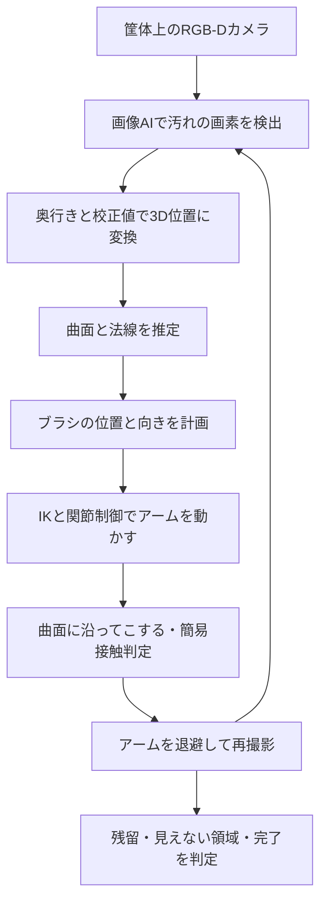

# 検討方針：固定筐体から便器の曲面を清掃する

## 合意した範囲（2026-10-24）

- 会社の大便器を想定。すべてシミュレーション。
- 便器前の筐体は固定。筐体上のカメラから俯瞰する。
- 対象は便器内側の一部分。汚れの位置・大きさ・形は試行ごとに変える。
- 清掃エリアは曲面。平らな板を拭く課題に置き換えない。
- トイレまでの移動・室内走行・ドア開閉は省く。

## おすすめの最小構成

固定筐体＋6～7軸アーム＋固定装着ブラシ＋俯瞰カメラ。
2026-10-24の追加希望により、接触は幾何判定を中心に簡略化する。手首の力・トルクセンサーは必須から外す。
アームは既存のURDFモデルの再利用を候補とする。機種は到達範囲・関節制限・Gazebo連携を確認して決定する。
道具の持ち替えと把持学習は省く。筐体はまず十分に固定されている前提とする。

カメラは、最初は**RGB-D（色と奥行き）**を提案する。ユーザー指定は俯瞰カメラであり、RGB-Dの採用は設計上の提案。
普通のRGBカメラだけを使う場合は、既知の便器CADとカメラの校正値から視線と曲面の交点を求める方式に変更する。
1枚のRGB画像だけから、未知の曲面の正確な奥行きが得られるとは仮定しない。

## ポイント1：ランダム汚れを「見る」

汚れは画像の上に貼るだけでなく、便器の表面座標に生成する。そうすれば視点が変わっても曲面に張り付いて見える。
位置、数（初期は1～3）、面積、濃さ、形状を乱数seedで変える。後から照明、反射、色、カメラ誤差を追加する。

最初は色しきい値の処理を比較対象として作り、その後、小型の画像セグメンテーションモデルを合成画像で学習する。
セグメンテーションとは「画像のどの画素が汚れか」を予測する処理。
シミュレータが知っている正解汚れ位置は、学習ラベルと採点用に限定し、本番のAI入力へ直接渡さない。

反射や影を汚れと取り違える例も用意する。評価用の汚れ配置・照明seedは学習と分ける。
同じ場面の連続フレームを学習用とテスト用へ分けるだけでは、未知の配置への対応は評価できない。

## ポイント2：曲面では「位置」と「向き」が必要

便器の壁は場所によって傾きが違う。同じ高さで横に動かしたり、ブラシを常に下向きにしたりすると、
面から浮く・深く押し込む・ブラシの端だけが当たる可能性がある。

清掃経路は曲面上で作り、各点で面の法線（面に垂直な向き）を求める。
法線に沿ってブラシを当て、面の接線方向へ往復させる。細かく形状が変わる箇所では経路間隔を狭くする。
ブラシは面積を持つので、中心点が到達できても全体が縁に衝突する場合がある。道具全体で衝突を確認する。

便器はまず楕円状の凹面で予備計算し、その後、実寸を参照した内壁・縁・底の異なる曲率を持つ形状へ進める。
特定メーカーの再現はCADが入手できてからとし、仮の形状を実物そのものとは呼ばない。
描画メッシュと衝突形状を別途検査し、便器内部を単一の凸形状で埋めてしまわないようにする。

## ポイント3：清掃は「近くを通った」だけでは成立させない

曲面とブラシの距離、面の法線との向き、接線方向の移動量を使って簡易判定する。
静止・浮遊・大きなめり込み・不適切な向きでは清掃回数を増やさない。
詳細な接触力、摩擦、ブラシの変形、アドミッタンス制御は今回の必須範囲から外す。
位置と向きを曲面に合わせる処理は残す。数値は仮想実験用の設定であり実機の安全条件ではない。

## 汚れが落ちる仕組みの簡略化

水・洗剤・毛の一本一本・汚れの化学的付着は計算しない。
表面上のセルごとに必要回数nと有効通過回数を保持し、**n回目の有効なこすりで消す**。
n回未満では見た目を変えない厳しめのケースをまず採用する。最新の定義は04の仕様を参照。
静止接触・空中移動では除去成功を与えない。
汚れの減り方は独自の代理モデルであり、現実の洗浄力・除菌・衛生状態を示すものではない。

## 俯瞰カメラの死角

筐体上からの斜め俯瞰では、手前の縁、深い側面、アーム自身が遮蔽物になる。
最初に「見える」「ブラシが届く」「対象としてよい」領域の共通部分を固定し、その中に汚れを生成する。
この条件は試行後に都合よく変更しない。別の難しいケースでは死角にも汚れを置き、清掃済みではなく未確認として報告する。

清掃後はアームを退避し、同じ観測姿勢で撮影する。見えない画素や深度欠損を、汚れゼロとみなさない。
領域全体が見えない場合は「観測できた範囲で完了」と「便器全体が完了」を区別する。

## 今回省くもの

室内移動、SLAM、ドア、便座開閉、道具交換、洗剤供給、流水、毛の詳細変形、実際の除菌評価。
一方、曲面形状、カメラの視点、ランダム汚れ、ブラシ姿勢、簡易接触判定、再観測は残す。
自然言語指示は主題ではないので、開始ボタンで十分。Step 1の分類AIを付けることは必須にしない。
