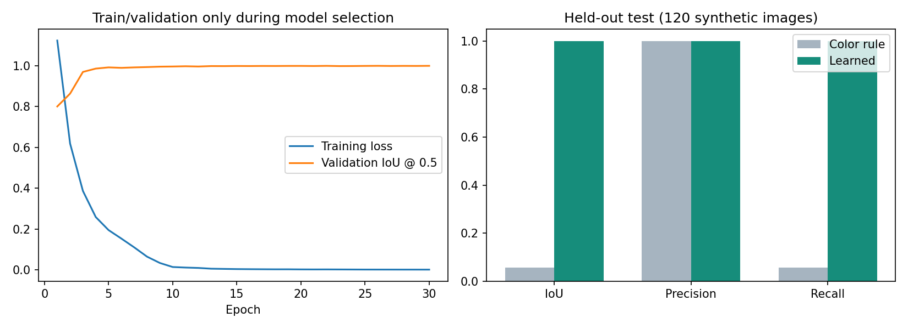

# 汚れを見分ける画像モデルの学習

## 何を学習させるか

RGB画像を入力し、各画素が汚れかどうかを予測する小型U-Netを使う。
乱数で初期化したモデルを、このラボで作った合成画像と正解マスクから学習する。
「茶色なら汚れ」と人が条件を書く代わりに、汚れの色・形・周囲との違いを画像と正解の組から学ぶ。

学習対象は画像認識だけ。3D座標変換、逆運動学、関節制限、衝突検査はアルゴリズムのまま。
必要こすり回数n、汚れの正解座標、乱数seedを推論入力には渡さない。

## 環境と分割

- このPCのNVIDIA GeForce RTX 4090をDockerのGPU接続で使用。
- `physical-ai-toilet:training`：PyTorch 2.9.1／CUDA 12.6系を追加した専用イメージ。
- train 600枚で重みを更新し、validation 120枚でモデルと判定しきい値を選ぶ。
- 設定と重みを凍結した後にtest 120枚で比較する。testを学習・調整には使わない。

PyTorchのインストール方法は公式の過去バージョン一覧を参照：
https://pytorch.org/get-started/previous-versions/

ネットワークはチャンネル数8・16・32・64の小型構成。学習済み外部モデルの重みは使わない。
最大30epoch、バッチ16、学習率0.001。重み付き二値交差エントロピーとDice損失を使用。
画像中の汚れは小さいため、背景だけを当てるモデルを高評価にしないようにする。
評価対象はあらかじめ固定した観測可能ROI。色判定も学習モデルも同じROIで比較する。

## 結果の読み方

- IoU：予測した汚れ領域と正解の重なり。高いほどよい。
- 再現率（Recall）：実際の汚れをどれだけ拾えたか。低いと見逃しが多い。
- 適合率（Precision）：汚れと予測した画素のうち本当に汚れだった割合。
- 汚れなし画像の誤検出：掃除不要なのに汚れがあると判断するケースを別に数える。

結果は `output/learning_v1/evaluation.json`、学習履歴は `history.json`。
validationで選んだepoch・しきい値とモデルのSHA256は `frozen_config.json` に記録する。
## 実行結果（2026-10-24）

RTX 4090で30epochを実行。学習とvalidation選択は約19.53秒（環境構築・データ読込は除く）。
122,817パラメータ、GPUの最大割当メモリ約1.39GB。validationで26epoch目・しきい値0.4を選び、重みと設定を固定してからtestを1回評価した。

| 未使用test 120枚 | 従来の茶色判定 | 学習モデル |
|---|---:|---:|
| IoU（領域の重なり） | 5.711% | 99.992% |
| 再現率（汚れを拾う割合） | 5.711% | 99.994% |
| 適合率（検出した画素の正しさ） | 100.000% | 99.997% |
| 見逃した汚れ画素 | 34,076 | 2 |
| 誤検出画素 | 0 | 1 |
| 汚れなし25枚のうち誤検出があった画像 | 0枚 | 0枚 |

画素の集計範囲は両方式で同じ固定ROI。testの正解汚れは計36,140画素。
学習済み重みの一致、推論入力・ROI制約、評価計算、および既存の幾何・接触・衝突検査を含む36テストが成功（39.351秒）。
実行環境のPythonパッケージ一覧は `output/learning_v1/environment.txt` に保存した。
極めて高い値は、この合成画像では汚れと背景の見分けが容易である可能性も示す。
別便器・濡れ・実物の反射・未知の汚れへの対応は、この試験では確認できない。
従来の単純な茶色条件との比較であり、十分に調整した全ての非学習方式に優れるという意味ではない。



[検出例](../output/learning_v1/test_predictions.png) は左から入力RGB、正解、学習モデル、従来方式。
ピンクが汚れ領域。先頭3枚と、評価後に誤差が大きい順で選んだ3枚を掲載した。選択後の再学習はしていない。

## 全体のゴールとの関係

今回できたのは「見る」の学習。次は、このモデルの検出結果を3D座標へ変換し、
「見る → 曲面をこする → 退避して見る → 残っていれば繰り返す」へ接続する。
異なる汚れ配置・必要回数nで、残留汚れ、不要な清掃、試行上限での停止、衝突検査結果を測る。
そこまで確認できれば、今回の限定範囲でのシミュレーション実証がひと区切りとなる。

## 再実行と利用

```powershell
cd ./physical_ai_toilet_lab
docker build -f Dockerfile.training -t physical-ai-toilet:training .
docker run --rm --network none --gpus all --mount "type=bind,source=$PWD,target=/work" physical-ai-toilet:training python3 train_segmentation.py
docker run --rm --network none --gpus all --mount "type=bind,source=$PWD,target=/work" physical-ai-toilet:training python3 evaluate_segmentation.py
```

凍結済みの学習や評価が存在する場合、スクリプトは上書きを止める。
追加実験は別の出力ディレクトリを設定し、testを見ながら同じ評価で調整を繰り返さない。

`scripts/learned_perception.py` の `LearnedDirtDetector.predict(rgb)` は汚れの真偽マスクを返す。
学習時の固定カメラに対応した320×240または640×480のRGB画像を受け付ける。
このアダプタ自体はロボットを動かさない。清掃ループに接続した動作評価は次の段階。

## 限界

評価画像は同じ仮便器・固定カメラ・固定撮影姿勢・同じ合成生成器から作ったもの。
異なるseedの評価であり、別の便器や実カメラへの汎化を証明する結果ではない。
汚れの除去や除菌効果を学習したわけでもない。
画像の検出精度が上がっても、清掃の成功率まで自動的に向上したとは結論しない。
